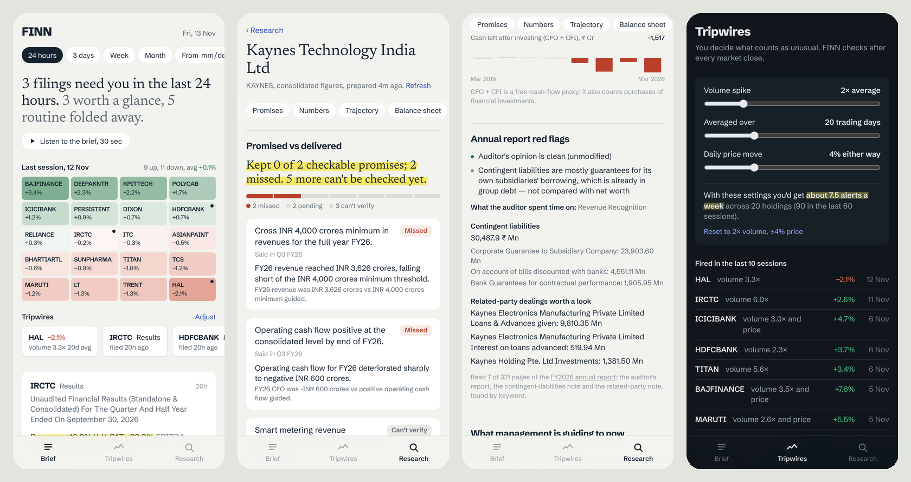

# FINN — what changed in your portfolio, and whether it matters

A mobile-first investing agent for Indian equities, built for the ENAM AI Engineer Build Challenge.

- **Brief (push):** every exchange filing across a 20-stock portfolio for the window you pick, ranked by materiality. Results arrive as headline numbers (Revenue, EBITDA, PBT, PAT, QoQ and YoY). Management changes arrive with who the incoming person is. Routine paperwork is folded away. Each card shows how the market took the filing, with a 30-day sparkline, and swipes away when handled. A pulse grid tints every holding by its move over the window, and a "Coming up" calendar pulls dates out of board-meeting notices. Dark mode follows the phone.
- **Tripwires (push):** you set what "unusual" means (volume ×, price move %, filing types). The screen tells you live how many alerts a week that setting would have produced, so you can calibrate noise before it happens.
- **Research (pull):** any NSE symbol. FINN reads the last five earnings-call transcripts and checks what management promised against what the filed numbers show. Then it gives trajectory, balance sheet, cash quality, current guidance and a bull/bear case. It also scans the latest annual report for the three things analysts check first: the auditor's opinion, contingent liabilities and related-party dealings. Primary sources only.
- **Listen:** the brief can be read aloud. The script is built in code from the ranked feed and spoken by the phone's own speech engine, so it costs nothing.

**Try it on a phone:** https://finn-92ls.vercel.app (add to home screen; it installs as an app). Or scan:




## How it works

```
GitHub Actions (daily, ~8 am + 4:15 pm IST)              Vercel (Next.js, mobile web app)
┌──────────────────────────────────────────────────┐           ┌───────────────────────────────┐
│ Yahoo EOD ─┐                                      │  commit   │ Brief / Tripwires read static  │
│ BSE filings ┼─ rules classify ─ score ─ cluster ──┼──JSON────▶│ JSON: instant, no waiting      │
│             └─ cheap model: leftovers, results    │           │                               │
│               tables, people, one-liners          │           │ Research: 3 staged API routes  │
│ file cache (committed) → each filing processed once│          │  base → extract×5 → analyze    │
└──────────────────────────────────────────────────┘           └───────────────────────────────┘
```

| Step | Who does it | Why |
|---|---|---|
| Classify filings | Regex rules on BSE category + subject; cheap model only for leftovers, 25 per call | Most filings are unambiguous; rules are free and deterministic |
| Rank | Explicit scoring function (`classify.ts`) | Ranking judgment should be readable and tunable, not hidden in a prompt |
| Results numbers | Cheap model **copies** the table; code converts units, derives EBITDA, computes QoQ/YoY, runs sanity checks | Models shouldn't do arithmetic; bad extractions get flagged, not shown silently |
| Exec bio | Filing's own "brief profile" first (SEBI requires one), then optional web search with a same-person check | Most reliable source first; avoid attaching a namesake's CV |
| Research numbers | screener.in tables → `metrics.ts` (pure code) | Every computable number is computed |
| Guidance | Cheap model, one call per transcript, cached forever per URL | A transcript never changes |
| Promise vs delivered, bull/bear | **One** strong-model call over compact extracted facts | The only step that needs reasoning |
| Annual report | Every page's text is extracted locally; ~7 pages are picked by keyword; one cheap call. "% of net worth" in code | A 500-page PDF costs about $0.001 instead of dollars |

Measured costs: a feed refresh is mostly cache hits (often zero new model calls). A fresh research report is 6 small-model calls plus 1 large-model call, about $0.01–0.015 (~₹1) at list price, and ₹0 on Gemini's free tier. Every number on screen is cross-checked or computed in code; see [DECISIONS.md](DECISIONS.md#what-real-data-broke-and-what-changed).

## Run it

```bash
npm install
cp .env.example .env.local      # add GEMINI_API_KEY (free at aistudio.google.com)
npm run sample                   # labelled sample data (fictional companies) for offline UI work
npm run pipeline                 # real data: prices + filings → public/data/feed.json
npm run prefetch                 # precompute research for the demo tickers
npm run dev                      # http://localhost:3000
npm test                         # offline tests for the deterministic parts
npm run check                    # verify portfolio BSE codes / Yahoo symbols
```

### Deploy
1. Import the repo on Vercel and set `GEMINI_API_KEY` (and optionally `TAVILY_API_KEY`, `UPSTASH_REDIS_REST_URL`/`TOKEN`).
2. In GitHub → Settings → Secrets → Actions, add the same `GEMINI_API_KEY` / `TAVILY_API_KEY`.
3. Actions → **Refresh data** → Run workflow; then **Prefetch research** → Run workflow. Each run commits data, which redeploys the app.

## Layout

```
src/lib/push/     prices, BSE filings, classifier + scoring, results extraction, people, summaries
src/lib/pull/     screener parser, deterministic metrics & flags, transcript guidance, analysis, annual-report scan
src/lib/speak.ts  the spoken brief (script built in code, no model)
src/lib/llm.ts    two-tier model router (cheap/strong), caching, cost accounting; Gemini or any OpenAI-compatible API
src/lib/alerts.ts tripwire logic (pure; also powers the live "alerts per week" calibration)
src/app/          Brief (/), Tripwires, Research + API routes
scripts/          pipeline, research prefetch, sample data, portfolio check
```

See [DECISIONS.md](DECISIONS.md) for the trade-offs and what was left out, and [BUILD_HISTORY.md](BUILD_HISTORY.md) (detailed, turn by turn) or [BUILD_LOG.md](BUILD_LOG.md) (one page) for how it was built with Claude.
